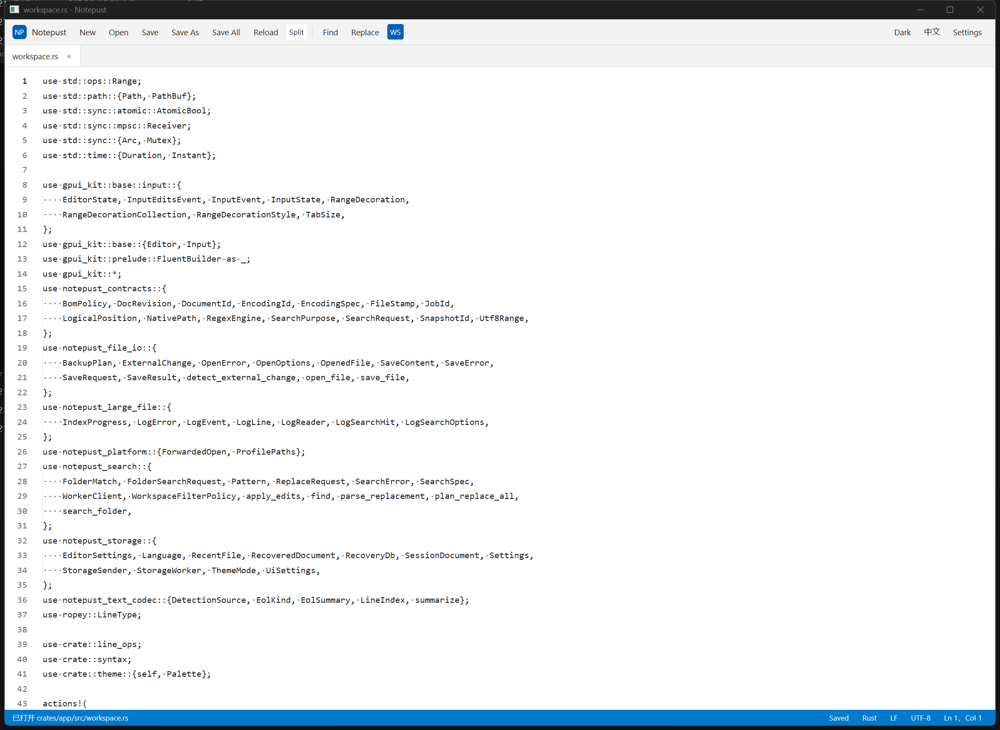

# Notepust

Notepust 是按 [PLAN.md](PLAN.md) 推进的 Windows 优先桌面编辑器，用来替代 Notepad++ 的日常文本、代码和配置文件编辑。界面使用 Rust + GPUI-Kit，核心模块与 GUI 分离，便于测试和后续扩展。

当前仓库已经是一个**可编译、可运行、带自动化测试**的工程，而不是只有规格。默认打开普通文件进行完整编辑；大日志 reader、搜索 worker、可靠保存和恢复库也已经实现为独立 crate。



## 现在可以做什么

- 新建、打开、保存、另存为、全部保存、从磁盘重载、多标签切换；关闭/重载有修改的标签需要二次确认；另存为到已打开文档的路径会被拒绝；欢迎页列出最近文件。
- 快速打开（`Ctrl+P`）按文件名/路径片段筛选当前目录文件；跳转行（`Ctrl+G`）；空白字符显示开关。
- 分屏：两个窗格显示不同标签，点击窗格切换当前文档；工具栏“分屏”开关。
- 行操作：复制/删除/上下移动/排序/去尾空格/注释/缩进，均可一次撤销；`Ctrl+Alt+↑/↓` 添加上下多光标；Kit 原生支持 Alt+点击和 Alt+Shift 拖动列选区。
- Tree-sitter 语法高亮与括号折叠，首批覆盖 Rust、C/C++、Python、JS/TS/TSX、JSON、YAML、TOML、Markdown、HTML/CSS、SQL、Shell；超过 2 MiB 的文档自动使用纯文本样式，避免输入卡顿。
- 设置面板（`Ctrl+,` 或工具栏“设置”）：界面字体、编辑字体、各自的备用字体链与字号，写入 `settings.toml` 并即时生效。
- 单实例：从资源管理器/命令行再次打开文件时转发到已运行窗口（命名 mutex + 命名管道），`--new-window` 可强制新开窗口。
- UTF-8、UTF-8 BOM、UTF-16 LE/BE、GBK、GB18030 等严格解码；无修改另存为可保留原始字节；点击状态栏编码可选择“重新解释为”或修改下次保存编码。
- 保留文件真实 CRLF/LF/CR；Enter 使用文档主导换行（通过本地 gpui-base 小补丁）。
- 当前文档查找/替换：字面量、常规正则、PCRE2 高级正则（前后查找/反向引用）、大小写、整词、全部替换、命中高亮和 F3 导航；高级模式通过独立 worker 执行。
- 只读日志内搜索：字面量与行级正则、大小写/整词、命中行高亮、F3 循环；搜索结果流式扫描，不加载整个文件（只读日志不提供替换）。
- 文件夹搜索：统一 ignore/globset 过滤、隐藏文件、编码/大小/二进制跳过原因、结果面板点击定位。
- 明暗主题、中英界面骨架、状态栏（行列、编码、EOL、语言、保存状态）。
- Windows 文件身份、同目录临时文件 + `ReplaceFileW` 可靠保存、保存前备份。
- SQLite 恢复检查点与最近会话；退出时同步写入最终检查点。
- 独立 `search-worker.exe`：标准 regex 与 PCRE2 高级模式、帧协议、硬取消/回收、替换 artifact；已通过进程级协议测试，查找条可直接启用。
- 只读大日志视图：超过 100 MiB 或单行超过 2 MiB 时自动进入日志模式；行号、分页、跟随/暂停、刷新、后台稀疏索引进度。1 GB 样本实测 0.4–0.8 秒首屏、约 79–83 MB 工作集。
- Windows 文件关联（`--register-file-types` / `--unregister-file-types`，仅 HKCU `Software\Classes`、不抢默认打开方式）与 NSIS 安装脚本 `installer/notepust.nsi`。

## 尚未接入首版的部分

日志内替换（日志按设计只读）、跨文件替换、文件树、命令面板、书签、单词补全与自动闭合 UI、INI/XML 专用语法、便携 ZIP 与代码签名。详见 [docs/FEATURE_STATUS.md](docs/FEATURE_STATUS.md)。

## 构建与运行

要求：Windows x64、稳定版 Rust（本机验证 1.100.0，MSVC 工具链）、Windows SDK。构建 SQLite/PCRE2 需要可用的 C 编译器（`cc` 可自动发现 MSVC）。

```powershell
cargo build -p notepust-app -p search-worker
cargo run -p notepust-app -- .\tests\fixtures\hello.txt
```

指定行列：

```powershell
cargo run -p notepust-app -- .\tests\fixtures\hello.txt --line 3 --column 1
```

测试与检查：

```powershell
cargo fmt --all --check
cargo clippy --workspace --all-targets -- -D warnings
cargo test --workspace
cargo build -p notepust-app -p search-worker --release
```

GUI 无头冒烟测试（启动窗口并核对标题）：

```powershell
.\tests\fixtures\smoke.ps1
```

大日志首屏/内存与截图（需要先生成 1 GB fixture）：

```powershell
.\tests\fixtures\log-smoke.ps1 -Configuration release
.\tests\fixtures\log-screenshot.ps1 -Configuration release
```

单实例转发（启动两个进程，验证第二个退出且第一个打开转发的文件）：

```powershell
.\tests\fixtures\single-instance-smoke.ps1 -Configuration debug
```

文件关联（只写当前用户；可逆）：

```powershell
.\target\release\notepust.exe --register-file-types
.\target\release\notepust.exe --unregister-file-types
```

安装包（需要 NSIS 3.x；先在仓库根目录构建 release）：

```powershell
makensis installer\notepust.nsi
```

## 快捷键

| 操作 | 快捷键 |
| --- | --- |
| 新建 / 打开 / 保存 / 另存为 | `Ctrl+N` / `Ctrl+O` / `Ctrl+S` / `Ctrl+Alt+S` |
| 全部保存 / 从磁盘重载 | `Ctrl+Shift+S` / `Ctrl+R`（脏文档需再按一次确认） |
| 关闭标签 | `Ctrl+W`（有修改时需再按一次确认） |
| 查找 / 替换 | `Ctrl+F` / `Ctrl+H` |
| 下一个 / 上一个命中 | `F3` / `Shift+F3` |
| 文件夹搜索 | `Ctrl+Shift+F` |
| 快速打开 / 跳转行 | `Ctrl+P` / `Ctrl+G` |
| 显示空白字符 | `Ctrl+Alt+W` |
| 编码面板 | `Ctrl+Alt+E` 或点击状态栏编码 |
| 高级正则（查找条） | 勾选 `PCRE2` |
| 设置面板 | `Ctrl+,` 或工具栏“设置” |
| 复制 / 删除行 | `Ctrl+Shift+D` / `Ctrl+Shift+K` |
| 上移 / 下移行 | `Alt+↑` / `Alt+↓` |
| 排序 / 去尾空格 | `Ctrl+Shift+L` / `Ctrl+Shift+T` |
| 切换注释 / 缩进 / 反缩进 | `Ctrl+/` / `Ctrl+]` / `Ctrl+[` |
| 上 / 下添加多光标 | `Ctrl+Alt+↑` / `Ctrl+Alt+↓` |
| 列选区 | `Alt+点击` 或 `Alt+Shift+拖动` |
| 下一个 / 上一个标签 | `Ctrl+Tab` / `Ctrl+Shift+Tab` |

## 目录

```text
crates/contracts       ID、坐标、编码、错误、任务协议
crates/text-codec      严格编解码、BOM、EOL、偏移与显示列
crates/file-io         打开、可靠保存、备份、外部修改检测
crates/storage         TOML 设置、SQLite 恢复/会话/保存日志
crates/search          匹配、替换计划、文件夹搜索、worker 监督
crates/large-file      ReadAt、稀疏行索引、视口、尾随
crates/platform        Windows 文件身份、进程、profile 路径
crates/search-worker   独立 regex 进程（不链接 GUI）
crates/app             GPUI-Kit 桌面应用（syntax / line_ops / workspace）
installer/             NSIS 安装脚本
crates/xtask           确定性 fixture 生成
vendor/gpui-base       0.10.0 + Enter 换行最小补丁
docs/                  规格与当前实现记录
```

## 数据安全

- 保存先写同目录临时文件、`flush` + `sync_all`，再对已有文件使用 `ReplaceFileW`；新文件不覆盖已存在路径。
- 打开后保留原始字节与内容摘要；保存前复查文件身份/长度/时间/摘要，发现外部变化返回冲突，不静默覆盖。
- 设置可开启保存前版本备份；恢复库对检查点做 BLAKE3 校验。
- 崩溃恢复副本以“恢复: …”未命名文档打开，保存时必须另存为，不覆盖原文件。

## 文档

- [产品计划](PLAN.md)
- [架构契约](docs/ARCHITECTURE.md)
- [当前功能状态](docs/FEATURE_STATUS.md)
- [M0 验证记录](docs/M0_RESULTS.md)
- [编辑内核决策](docs/adr/editor-kernel.md)
- [搜索与大日志规格](docs/SEARCH_LARGEFILE_SPEC.md)
- [文件与恢复规格](docs/FILE_IO_RECOVERY_SPEC.md)
- [安装、便携模式与文件关联](docs/INSTALLER.md)
- [v0.1.0 发布说明](docs/RELEASE_NOTES_v0.1.0.md)
- [更新日志](CHANGELOG.md)

## 许可证

MIT OR Apache-2.0，见 [LICENSE-MIT](LICENSE-MIT) 与 [LICENSE-APACHE](LICENSE-APACHE)。

`vendor/gpui-base` 是 GPUI-Base 0.10.0 的本地副本，保留了上游许可证与最小补丁说明。
